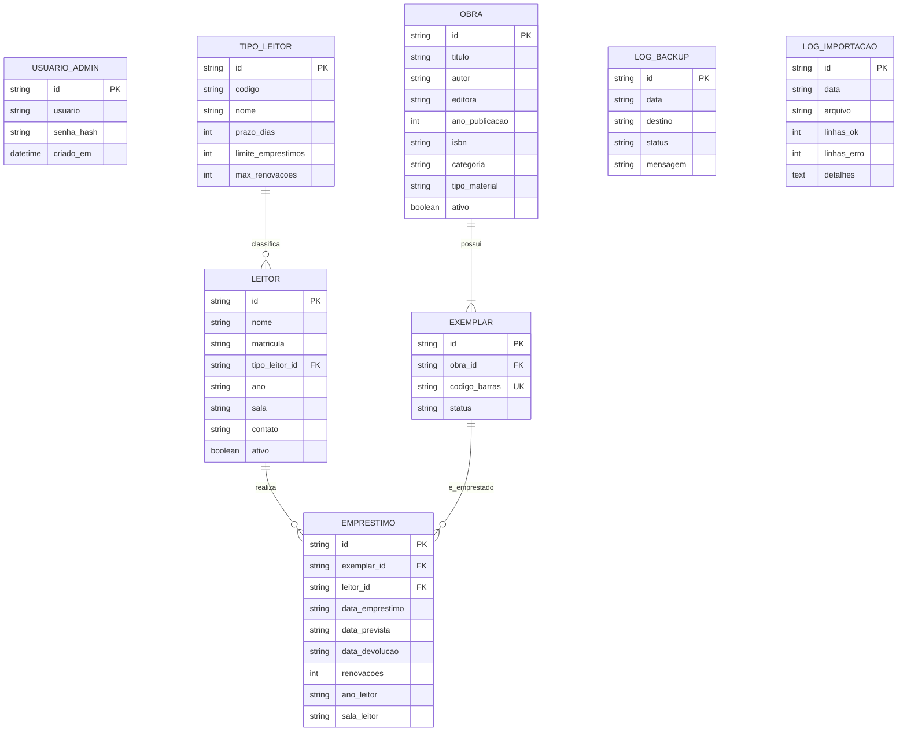

# Modelo Entidade-Relacionamento (ER)

## Regras de Integridade e Snapshots
- **Snapshot de Ano e Sala**: No momento do empréstimo, os valores de `ano` e `sala` do leitor são copiados para as colunas `ano_leitor` e `sala_leitor` do registro de `EMPRESTIMO`. Isso garante que relatórios históricos e estatísticas por turma permaneçam precisos mesmo após o aluno mudar de série ou sala.
